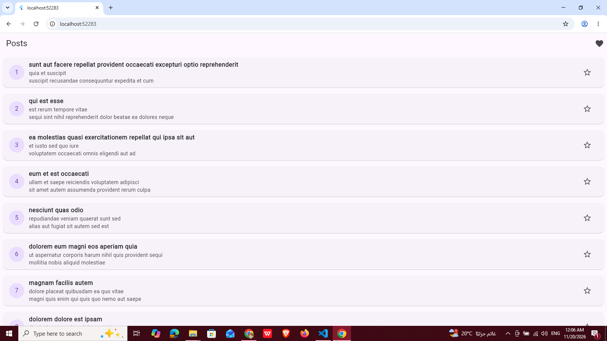
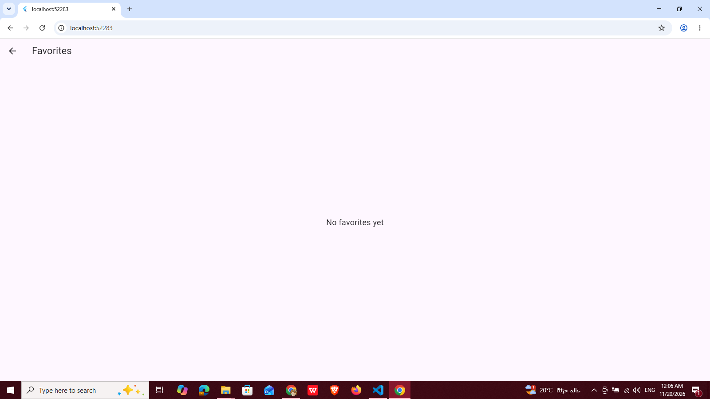
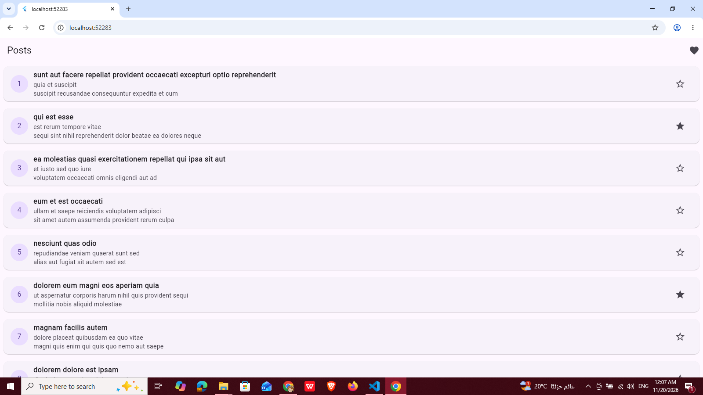
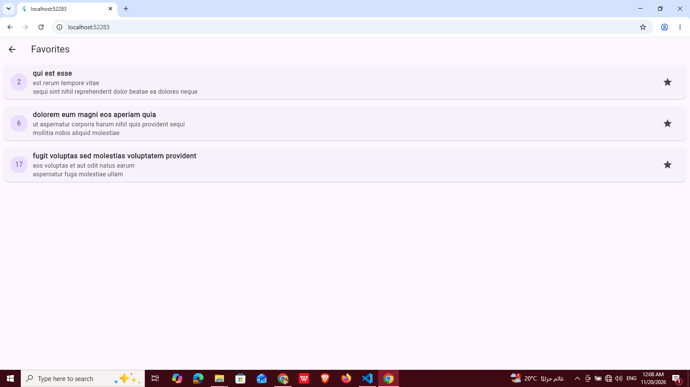

# Offline Posts App (Flutter + Hive)

A Flutter app that fetches posts from [JSONPlaceholder](https://jsonplaceholder.typicode.com/posts), caches them locally with **Hive**, and keeps working without internet. Users can mark posts as favorites, which are stored in their own Hive box and survive refreshes and app restarts.

> Note: the post text is Latin-looking filler ("lorem ipsum") provided by the JSONPlaceholder test API.

## Features
- Fetch posts from the API and cache them in Hive (`postsBox`)
- Offline mode: the last saved posts are shown when there is no internet
- Favorites: tap the star on any post to add or remove it
- Star icon updates immediately (filled = favorite, outlined = not)
- Favorites screen opened from the AppBar heart button
- Friendly "No favorites yet" message when the list is empty
- Favorites are stored in a separate box (`favoritesBox`) so they persist

## How it works
```
INTERNET -> API -> Hive -> ListView
```

`PostService.getPosts()` tries the API first. On success it clears `postsBox`, saves the new posts and returns them. On failure it returns the posts stored in Hive, or throws `No Internet and No Cached Data`.

**Why a separate box for favorites?** `getPosts()` calls `postsBox.clear()` on every refresh, which would wipe the favorites. Also, a `HiveObject` can only live in one box, so `FavoritesService` saves a **copy** of the post, using the post id as the key.

## Project structure
```
lib/
├── main.dart                      # init Hive, register adapter, open boxes
├── models/
│   ├── post_model.dart            # Post + Hive annotations
│   └── post_model.g.dart          # generated
├── services/
│   ├── post_service.dart          # API + Hive logic
│   └── favorites_service.dart     # toggleFavorite, isFavorite, getFavorites
└── screens/
    ├── posts_screen.dart          # posts list + star + AppBar favorites button
    └── favorites_screen.dart      # saved favorites
```

## Run the project
```bash
flutter pub get
dart run build_runner build --delete-conflicting-outputs
flutter run
```

## Screenshots

### 1. Posts loaded from the API
All posts are shown with outlined stars and a Favorites button in the AppBar.



### 2. Empty favorites state
When no post is saved, the Favorites screen shows "No favorites yet".



### 3. Favorites list
Saved posts appear with the same card design as the posts list.


### 4. Starring posts
Tapping a star toggles the favorite and the icon updates immediately (posts 2 and 6 are filled).



### 5. Favorites saved in Hive with no internet connection
The Favorites screen shows the saved posts, stored in `favoritesBox`.


